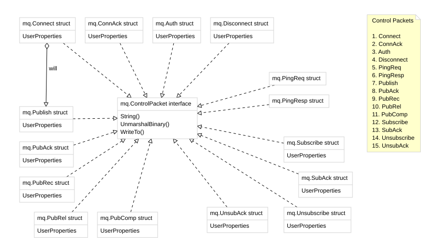

ARCHIVED! Moved to https://sogvin.com/mq

[gregoryv/mq](https://pkg.go.dev/github.com/gregoryv/mq) - package implements
[mqtt-v5.0](https://docs.oasis-open.org/mqtt/mqtt/v5.0/os/mqtt-v5.0-os.html) control
packets

For a low level client implementation refer to [gregoryv/tt](https://github.com/gregoryv/tt)

Naming concepts follow the specification as much as possible.

Initial work and design is discussed in [etc/blog.md](./etc/blog.md).
